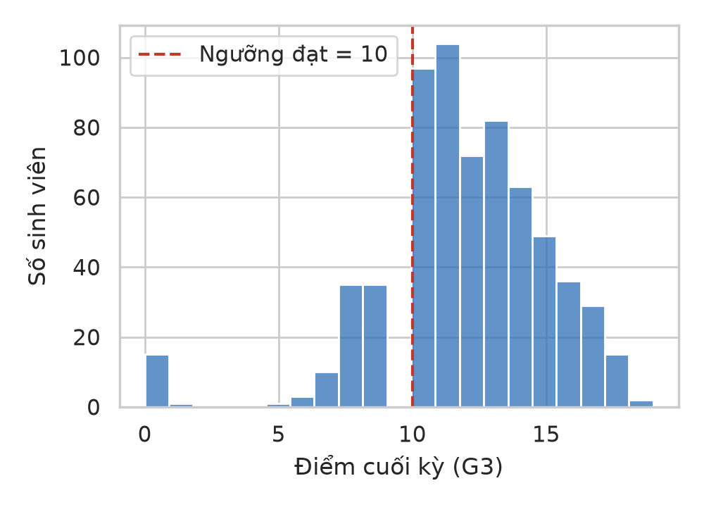
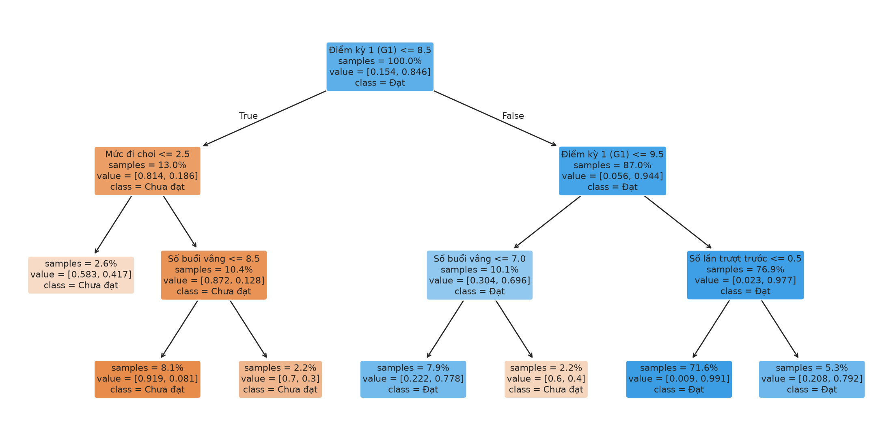
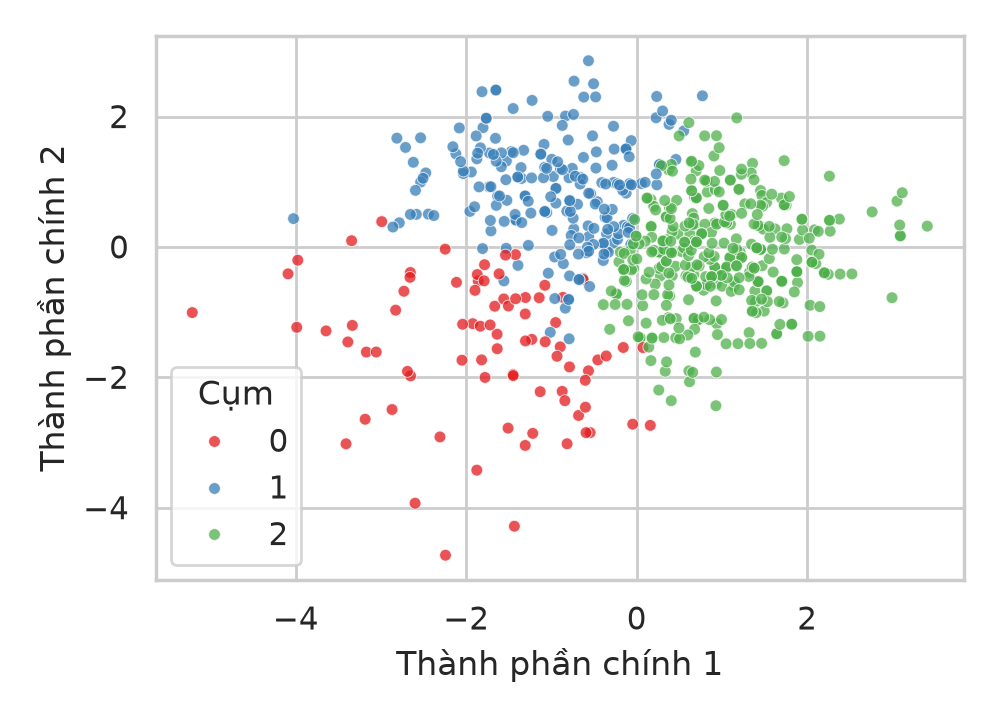

# Dự đoán kết quả học tập bằng học máy
Năng lực số nâng cao – Đại học Cần Thơ

## Bối cảnh và câu hỏi nghiên cứu
- Khoảng 15% học sinh trong dữ liệu không đạt môn học
- Câu hỏi: những yếu tố nào báo hiệu sớm nguy cơ không đạt?
- Mục tiêu: phân loại, phân nhóm người học và dự đoán điểm cuối kỳ

## Dữ liệu
- UCI Student Performance – 649 học sinh, 33 thuộc tính
- Giấy phép CC BY 4.0, dữ liệu đã ẩn danh
- Nhãn: Đạt nếu điểm cuối kỳ G3 ≥ 10 (thang 20)

## Phương pháp
- Làm sạch dữ liệu bằng pandas
- Cây quyết định (độ sâu 3) để phân loại Đạt / Chưa đạt
- K-Means (k = 3) để gom nhóm theo hành vi học tập
- Hồi quy tuyến tính để dự đoán điểm G3

## Kết quả: cây quyết định
- Độ chính xác 88,2% trên tập kiểm tra
- Điểm kỳ 1 (G1) là đặc trưng quan trọng nhất
- Số buổi vắng và số lần trượt là tín hiệu cảnh báo phụ

## Kết quả: gom nhóm và hồi quy
- Cụm rủi ro: G1 ≈ 8, từng trượt môn, tỷ lệ đạt 45%
- Cụm tốt: G1 ≈ 12,6, tự học nhiều, tỷ lệ đạt 95%
- Hồi quy dự đoán G3 với R² = 0,88

## Kết luận và hướng phát triển
- Có thể cảnh báo sớm ngay sau kỳ 1
- Đề xuất phụ đạo cho nhóm có G1 thấp và vắng nhiều
- Mở rộng: Random Forest, dữ liệu học sinh Việt Nam
